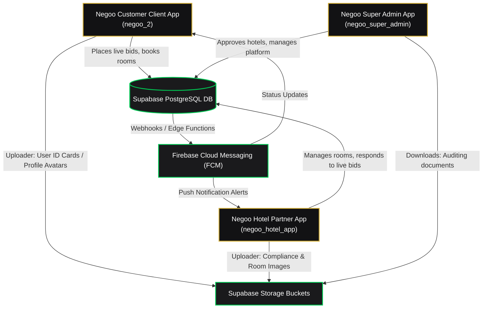
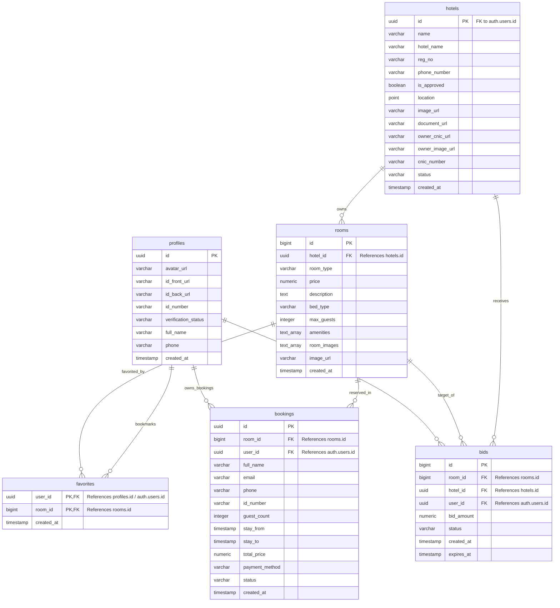
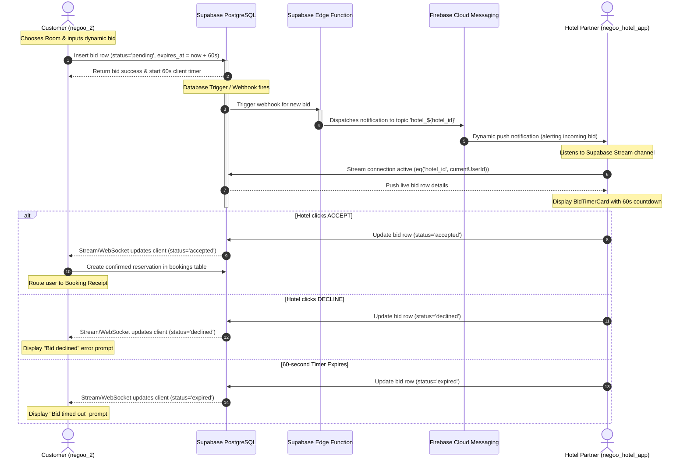
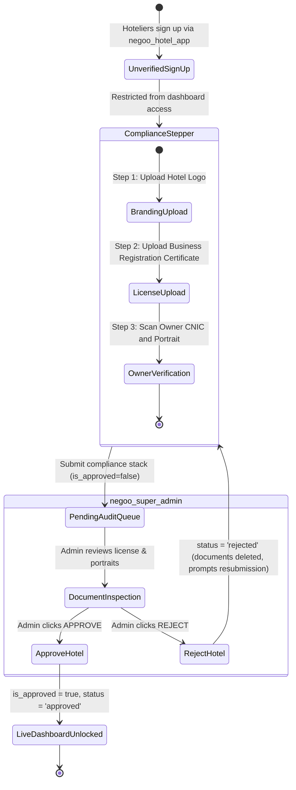

# Negoo Hospitality Platform: Ecosystem Architecture & Database Report

This report provides an in-depth technical analysis and architectural overview of the **Negoo** hospitality and live-bidding ecosystem. It details the system architecture, technology stack, database schemas, Entity Relationship Diagram (ERD), Unified Modeling Language (UML) diagrams, and the core relationships between the three client applications that comprise the ecosystem.

---

## 1. Executive Summary & Ecosystem Relationships

The Negoo platform is a real-time, bidding-centric hospitality booking marketplace that bridges the gap between hotel properties and prospective guests. Unlike traditional booking websites, Negoo enables a dynamic **Live Bidding** mechanism where users can propose a custom payout rate for standard hotel rooms, and hotel partners have a limited 60-second time-window to accept or decline the offer.

The codebase consists of three core cross-platform client applications, all communicating with a single shared cloud database backend:



### Roles and Project Connections
1. **Negoo Customer App ([negoo_2](file:///d:/negoo_2))**: 
   * **Target User**: Travelers and hotel guests.
   * **Core Files**: [main.dart](file:///d:/negoo_2/lib/main.dart), [user-dashboard.dart](file:///d:/negoo_2/lib/user/user-dashboard.dart), [bidding_screen.dart](file:///d:/negoo_2/lib/user/bidding_screen.dart), [booking-screen.dart](file:///d:/negoo_2/lib/user/booking-screen.dart), and [fav_screen.dart](file:///d:/negoo_2/lib/user/fav_screen.dart).
   * **Key Features**: Location-based hotel discovery via Google Maps & Geolocator, suite browsing, standard bookings, room favoriting, and initiating a 60-second real-time bidding session on a room price.
2. **Negoo Partner Console ([negoo_hotel_app](file:///d:/negoo_hotel_app))**:
   * **Target User**: Hotel owners and front-desk managers.
   * **Core Files**: [main.dart](file:///d:/negoo_hotel_app/lib/main.dart), [dashboard.dart](file:///d:/negoo_hotel_app/lib/dashboard.dart), [live_bids_tab.dart](file:///d:/negoo_hotel_app/lib/live_bids_tab.dart), [rooms_tab.dart](file:///d:/negoo_hotel_app/lib/rooms_tab.dart), [financials_tab.dart](file:///d:/negoo_hotel_app/lib/financials_tab.dart), and [verification.dart](file:///d:/negoo_hotel_app/lib/verification.dart).
   * **Key Features**: Registration & compliance documentation uploads (license, owner CNIC, owner photo), room inventory configuration, financial statement review (marketplace fee calculations), and a live WebSocket dashboard to listen and respond to incoming bids.
3. **Negoo Central Admin Console ([negoo_super_admin](file:///d:/negoo_super_admin))**:
   * **Target User**: Negoo platform operators.
   * **Core Files**: [main.dart](file:///d:/negoo_super_admin/lib/main.dart), [AdminMetricsDashboard.dart](file:///d:/negoo_super_admin/lib/AdminMetricsDashboard.dart), [AdminHotelPipelineScreen.dart](file:///d:/negoo_super_admin/lib/AdminHotelPipelineScreen.dart), and [AdminPartnerManagementScreen.dart](file:///d:/negoo_super_admin/lib/AdminPartnerManagementScreen.dart).
   * **Key Features**: Auditing compliance documents uploaded by hotel partners, toggling approval states (`is_approved`), deleting unauthorized partners, and viewing platform-wide financial statistics.

---

## 2. Technology Stack & Ecosystem Details

The platform utilizes a modern, serverless mobile-first architecture optimized for low-latency state synchronization.

| Technology Component | Selection | Implementation Detail |
| :--- | :--- | :--- |
| **Frontend Framework** | **Flutter (Dart SDK)** | Single codebase compiling to native Android, iOS, and Web layouts. Uses dark-themed premium design languages. |
| **Database Backend** | **PostgreSQL (Supabase)** | Relational database handling transactions, geolocation metrics, and relational constraints. |
| **Real-time Engine** | **Supabase Realtime WebSockets** | Persistent duplex channels used to stream real-time updates of incoming bids and room status changes to the client apps. |
| **Cloud Storage** | **Supabase Storage** | File buckets storing asset vaults such as logo files, license certificates, CNIC scans, and room galleries. |
| **Push Notifications** | **Firebase Cloud Messaging** | Background message delivery. Devices subscribe to targeted topics (`hotel_${hotel_id}`) to wake client apps during new bid arrivals. |
| **Mapping & Location** | **Google Maps & Geolocator** | Calculates spatial query parameters for finding nearby properties (using `POINT(longitude latitude)` formatting). |

---

## 3. Database Schema & Entity Relationship Diagram (ERD)

The database runs on Supabase (PostgreSQL), utilizing foreign-key constraints to guarantee database integrity.

### Entity Relationship Diagram (ERD)

The diagram below details the schema structure, primary-to-foreign key mappings, and cardinality relations of the Negoo ecosystem:



### Table Specifications

#### A. `profiles` (User Profiles Schema)
Holds profile metadata and compliance verification documents for general customers.
* `id` (UUID, Primary Key, referencing `auth.users.id`)
* `avatar_url` (VARCHAR, URL to customer avatar photo)
* `id_front_url` (VARCHAR, URL to front scan of ID card)
* `id_back_url` (VARCHAR, URL to back scan of ID card)
* `id_number` (VARCHAR, CNIC or Passport number)
* `verification_status` (VARCHAR, e.g., `'pending'`, `'verified'`)
* `full_name` (VARCHAR, User's full display name)
* `phone` (VARCHAR, Telephone number)
* `created_at` (TIMESTAMP WITH TIME ZONE)

#### B. `hotels` (Partner Profile Schema)
Holds the registration details, approval status, geographical location, and compliance files for each hotel.
* `id` (UUID, Primary Key, referencing `auth.users.id`)
* `name` / `hotel_name` (VARCHAR, name of the hotel)
* `reg_no` (VARCHAR, regulatory registration number)
* `phone_number` (VARCHAR, contact number)
* `is_approved` (BOOLEAN, defaults to `false`)
* `location` (GEOMETRY POINT, coordinates formatted as `POINT(longitude latitude)`)
* `image_url` (VARCHAR, URL to hotel logo)
* `document_url` (VARCHAR, URL to registration document certificate)
* `owner_cnic_url` (VARCHAR, URL to CNIC scan)
* `owner_image_url` (VARCHAR, URL to portrait photo)
* `cnic_number` (VARCHAR, Owner CNIC numerical format)
* `status` (VARCHAR, status check: `'pending'`, `'approved'`, or `'rejected'`)
* `created_at` (TIMESTAMP WITH TIME ZONE)

#### C. `rooms` (Inventory Schema)
Details the rooms listed under each hotel.
* `id` (BIGINT, Primary Key, autogenerated)
* `hotel_id` (UUID, Foreign Key referencing `hotels.id` on delete cascade)
* `room_type` (VARCHAR, e.g., "Presidential Suite")
* `price` (NUMERIC, nightly standard price)
* `description` (TEXT)
* `bed_type` (VARCHAR, e.g., "King Size")
* `max_guests` (INTEGER)
* `amenities` (TEXT ARRAY, list of room features)
* `room_images` (TEXT ARRAY, URLs to gallery photos)
* `image_url` (VARCHAR, thumbnail image URL)
* `created_at` (TIMESTAMP WITH TIME ZONE)

#### D. `favorites` (Customer Bookmark Junction Table)
Maps favorited suites/rooms to specific customer profile entities.
* `user_id` (UUID, Primary Key, Foreign Key referencing `profiles.id` on delete cascade)
* `room_id` (BIGINT, Primary Key, Foreign Key referencing `rooms.id` on delete cascade)
* `created_at` (TIMESTAMP WITH TIME ZONE)

#### E. `bids` (Live Bidding Transaction Schema)
Manages the temporary 60-second bidding sessions.
* `id` (BIGINT, Primary Key, autogenerated)
* `room_id` (BIGINT, Foreign Key referencing `rooms.id` on delete cascade)
* `hotel_id` (UUID, Foreign Key referencing `hotels.id` on delete cascade)
* `user_id` (UUID, Foreign Key referencing `auth.users.id` on delete cascade)
* `bid_amount` (NUMERIC, price offered by guest)
* `status` (VARCHAR, defaults to `'pending'`; transitions to `'accepted'`, `'declined'`, `'expired'`)
* `created_at` (TIMESTAMP WITH TIME ZONE)
* `expires_at` (TIMESTAMP WITH TIME ZONE, expiration cutoff: `created_at + 60 seconds`)

#### F. `bookings` (Reservation Ledger Schema)
Maintains finalized reservations (regular bookings or accepted bids).
* `id` (UUID, Primary Key, autogenerated)
* `room_id` (BIGINT, Foreign Key referencing `rooms.id` on delete restrict)
* `user_id` (UUID, Foreign Key referencing `auth.users.id` on delete restrict)
* `full_name` (VARCHAR, primary guest name)
* `email` (VARCHAR)
* `phone` (VARCHAR)
* `id_number` (VARCHAR, CNIC or Passport)
* `guest_count` (INTEGER)
* `stay_from` (TIMESTAMP WITH TIME ZONE)
* `stay_to` (TIMESTAMP WITH TIME ZONE)
* `total_price` (NUMERIC)
* `payment_method` (VARCHAR, e.g., `'cash'`, `'card'`, `'mobile_wallet'`)
* `status` (VARCHAR, e.g., `'pending'`, `'confirmed'`, `'declined'`, `'paid'`)
* `created_at` (TIMESTAMP WITH TIME ZONE)

---

## 4. Unified Modeling Language (UML) Diagrams

### A. Use Case Diagram
Describes the system boundaries and interaction roles of the three main platform stakeholders.

```mermaid
leftToRightDirection
actor Customer as "Customer (negoo_2)"
actor Partner as "Hotel Partner (negoo_hotel_app)"
actor Admin as "Super Admin (negoo_super_admin)"

rectangle "Negoo Platform" {
    usecase UC1 as "Browse Hotels & Rooms"
    usecase UC2 as "Book standard Room"
    usecase UC3 as "Submit Live Bid Offer (60s)"
    usecase UC4 as "Verify Bid Results"
    usecase UC4_1 as "Bookmark/Favorite Room"
    
    usecase UC5 as "Submit Verification & Docs"
    usecase UC6 as "Manage Suites / Room Inventory"
    usecase UC7 as "Listen to Live Bids in Real-time"
    usecase UC8 as "Accept / Decline Live Bid"
    usecase UC9 as "Review Financial Statement"
    
    usecase UC10 as "Review Pending Partnerships"
    usecase UC11 as "Approve / Reject Hotel License"
    usecase UC12 as "Monitor Platform Analytics & Fees"
    usecase UC13 as "Terminate & Delete Partner Row"
}

Customer --> UC1
Customer --> UC2
Customer --> UC3
Customer --> UC4
Customer --> UC4_1

Partner --> UC5
Partner --> UC6
Partner --> UC7
Partner --> UC8
Partner --> UC9

Admin --> UC10
Admin --> UC11
Admin --> UC12
Admin --> UC13
```

### B. Sequence Diagram: Live Bidding Flow
Illustrates the chronological interaction sequence between components when a customer submits a live price offer.



### C. Component Architecture Diagram
Demonstrates the high-level physical modularization of the codebase.

```mermaid
component {
  [Client Interface Layer] as Client
  [Ecosystem Core Apps] as Apps
  [Backend Service Core] as Backend
}

package "Flutter Apps" {
  [negoo_2] as N2App
  [negoo_hotel_app] as NHApp
  [negoo_super_admin] as NSApp
}

package "Supabase Backend Integration" {
  [Supabase Auth] as Auth
  [PostgreSQL Database] as PG
  [Realtime Stream Service] as WS
  [Storage Buckets] as Storage
}

package "Push Notifications" {
  [Firebase Cloud Messaging] as FCM
}

N2App --> Auth : User Sign In
NHApp --> Auth : Partner Sign In
NSApp --> Auth : Admin Sign In

N2App --> PG : Read Rooms / Create Bookings / Bids
NHApp --> PG : Read Bookings / Update Bid Status
NSApp --> PG : Read Hotels / Update is_approved

NHApp -.-> WS : Stream incoming bids
N2App -.-> WS : Listen to bid responses

NHApp --> Storage : Upload logo, documents & room photos
N2App --> Storage : Upload profile & ID photos
NSApp --> Storage : Retrieve documents for compliance inspection

PG --> FCM : Webhook integration triggers messages
FCM --> NHApp : Wake-up / Alert topic subscribers
```

---

## 5. Supabase & Database Table Relations Detail

Supabase provides the shared core engine for the entire Negoo platform, tying the customer, hotel partner, and super admin apps together. 

### WebSocket / Stream Subscriptions
Rather than using heavy polling mechanisms, client apps leverage the **Supabase Realtime Stream Protocol** to maintain reactive UIs:
- **Customer App (`negoo_2`)** subscribes to the `bids` table filtered by `user_id`. When the hotel partner updates the status of the bid (transitions from `'pending'` to `'accepted'` or `'declined'`), the update is immediately sent down the WebSocket channel to fire the UI decision dialog box.
- **Hotel Partner App (`negoo_hotel_app`)** subscribes to the `bids` table filtered by `hotel_id` where `status = 'pending'`. The incoming stream triggers the dynamically calculated countdown cards (`BidTimerCard`) on the hoteliers' dashboard.
- **Super Admin App (`negoo_super_admin`)** listens to the `hotels` table changes. The pipeline screen automatically updates when new hoteliers register, listing them in the audit queue.

### Storage Buckets Layout

Supabase Storage is partitioned into security-fenced buckets:

1. **`verification` (Partner Uploads)**:
   - Holds hotel logo images: `verification_vault/${userId}/hotel_logo_...`
   - Holds business licenses: `verification_vault/${userId}/registration_license_...`
   - Holds owner CNIC scans: `verification_vault/${userId}/owner_cnic_...`
   - Holds owner portraits: `verification_vault/${userId}/owner_portrait_...`
2. **`verification-docs` (User Uploads)**:
   - Holds customer ID card front/back images and profile face verifications.
3. **`avatars`**:
   - Holds customer account profile avatars.
4. **`hotel-docs`**:
   - Secondary bucket utilized for hotel registration files.

> [!IMPORTANT]
> Bucket policies enforce Row Level Security (RLS). Users can only write files to folders prepended with their authenticated `uid`. The `negoo_super_admin` has administrative policies that allow read access to all files in `verification` and `verification-docs` to facilitate manual audits.

---

## 6. Firebase Role & Live Bidding Sync Connection

While Supabase handles transactional storage and real-time streams for open apps, **Firebase Cloud Messaging (FCM)** is the primary mechanism to bridge background execution states and wake up offline or backgrounded client apps.

### Firebase Role
- **Background Wake-Up**: When a user inserts a bid, the hotel partner might not have their application open in the foreground. Firebase Messaging acts as a low-power background listener.
- **Notification Topics Routing**:
  - Hoteliers subscribe to a Firebase notification topic named `hotel_${hotel_id}` upon authentication.
  - Customers subscribe to a topic named `user_${user_id}`.
- **Notification Payloads**: Contains structured notification alerts, prompting the OS drawer to wake up the application and navigate directly to the incoming live bid screen.

### Connection Workflow for Live Bidding
The real-time bidding process connects Supabase and Firebase via the following sequence:

```
[Customer App] (Insert bid row status='pending')
       │
       ▼
[Supabase DB] ──► (Webhook Event Trigger) ──► [Supabase Edge Function]
                                                        │
                                                        ▼
                                               [Firebase Admin API]
                                                        │
                                                        ▼
[Hotel Partner App] ◄── (OS Notification Alert) ◄─── [FCM Topics]
       │
 (Establish Realtime WebSocket connection)
       │
       ▼
[Supabase Realtime Stream] ──► Streams active bid data ──► UI countdown card initialized
```

1. **Bidding Initiation**: A user inserts a row inside the `bids` table with `status = 'pending'`.
2. **Database webhook**: A PostgreSQL webhook fires on insert events, notifying a serverless Supabase Edge Function.
3. **FCM Dispatch**: The Edge Function translates the database payload, extracts the `hotel_id`, and makes a POST call to the Firebase Admin API targeting the topic `hotel_${hotel_id}`.
4. **Partner Push Notification**: FCM pushes a background message to all devices registered under the hotel partner's topic.
5. **Real-time Stream Sync**: The hotel partner opens the app. The dashboard initiates a Supabase Realtime channel stream `Supabase.instance.client.from('bids').stream(primaryKey: ['id']).eq('hotel_id', currentHotelId)`.
6. **Decision Propagation**: The partner accepts or declines. This issues an `update` SQL query to Supabase.
7. **Client Feedback**: The user app (which has a listener on the `bids` table filtered by `user_id`) intercepts the updated row instantly via the websocket connection and notifies the user of the hotel's decision.

---

## 7. Ecosystem Financial Calculation Logic

The partner console implements automated financial metrics tracking. Gross revenues and platform cuts are calculated automatically on the client side:

1. **Gross Confirmed Revenue ($$R_G$$)**:
   Calculated as the sum of `total_price` for all records in the `bookings` table targeting rooms belonging to the specific `hotel_id` where `status = 'confirmed'` or `status = 'paid'`.
   
2. **Negoo Marketplace Fee ($$F_M$$)**:
   Set to **10%** of the gross revenue.
   $$F_M = R_G \times 0.10$$
   
3. **Net Retained Balance ($$B_N$$)**:
   The final sum paid out to the hotel partner after fees.
   $$B_N = R_G - F_M = R_G \times 0.90$$

These metrics are compiled in [financials_tab.dart](file:///d:/negoo_hotel_app/lib/financials_tab.dart) and presented inside a sleek glassmorphic container:
* Gross confirmed bookings are summarized.
* The 10% commission fee is extracted.
* Net retained balance is presented alongside a list of confirmed booking ledgers.

---

## 8. Compliance, Auditing & Deployment Workflow

To prevent unverified vendors from listing fake hotel listings, the ecosystem implements a strict compliance validation stepper.



1. **Restricted Dashboard Access**: Upon registration in `negoo_hotel_app`, the user is directed to the `HotelPendingScreen` ([pending.dart](file:///d:/negoo_hotel_app/lib/pending.dart)) where they cannot view or write rooms, bids, or financial statements.
2. **Compliance Stepper Uploads**: Hoteliers complete the compliance uploads inside [verification.dart](file:///d:/negoo_hotel_app/lib/verification.dart):
   * **Branding**: Logo upload (saved to Storage `verification_vault/${userId}/hotel_logo_...`).
   * **Business Registration**: Regulatory registration number and license certificate image upload.
   * **Owner Identification**: Portrait image scan and CNIC card scan.
3. **Admin Audit Queue**: Once submitted, a record is added/updated in the `hotels` table with `status = 'pending'` and `is_approved = false`. The hotel is placed in the **Document Validation Queue** inside `negoo_super_admin` ([AdminHotelPipelineScreen.dart](file:///d:/negoo_super_admin/lib/AdminHotelPipelineScreen.dart)).
4. **Verification Evaluation**: 
   * **Approval**: If the admin approves, `is_approved` transitions to `true` and `status` to `'approved'`. The hotel dashboard unlocks room editing, bidding listeners, and cash flows.
   * **Rejection**: If the admin rejects, `status` becomes `'rejected'`. The file URLs in Supabase Storage are deleted, and the hoteliers' console prompts them to resubmit valid files.
