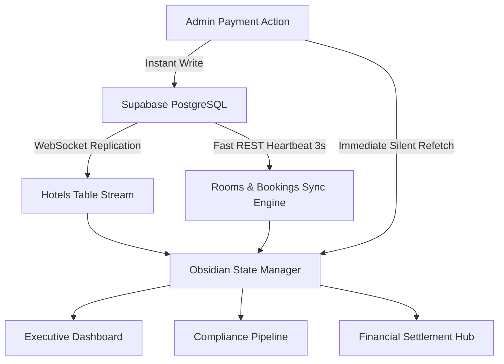

<div align="center">

# 🛡️ NEGOO HQ — CENTRAL COMMAND
### Enterprise Super Administration, Compliance & Financial Settlement Terminal

[](https://flutter.dev)
[](https://dart.dev)
[](https://supabase.com)
[](https://flutter.dev/multi-platform)
[](#license)

**A high-performance, real-time command terminal engineered for Negoo's hospitality platform leadership.**  
Designed with an Obsidian & Gold luxury aesthetic, military-grade compliance auditing, and continuous real-time ledger synchronization.

---

</div>

## 📌 Executive Overview

**Negoo HQ Central Command** is the operational backbone for managing the Negoo hotel bidding and reservation ecosystem. It gives platform executives and compliance officers full observability and immediate control over partner onboarding, regulatory compliance, booking volumes, platform revenue splits (10% commission), and partner treasury settlements.

---

## 🌟 Core System Modules

### 1. 📊 Executive Intelligence (`AdminMetricsDashboard`)
* **Real-time KPI Telemetry**: Live trackers for Active Partner Venues, Gross Booking Volume, Net Negoo Platform Commission (10%), and Pending Compliance Queue.
* **Commercial Property Distribution**: Dynamic donut charts (`fl_chart`) classifying partner fleets across Approved, Pending, and Rejected states.
* **Infrastructure Telemetry Monitor**: Visual health indicators for Supabase WebSocket Low-Latency Channels, PostGIS Geo-Nodes, and PostgreSQL Row-Level Security (RLS) clearance.
* **Live Activity & Audit Feed**: Real-time event stream logging property registrations, compliance actions, and verified reservations.

---

### 2. 📑 Partner Validation & Compliance Terminal (`AdminHotelPipelineScreen`)
* **Tri-State Lifecycle Pipeline**: Segmented management across **Pending Compliance**, **Approved Partners**, and **Rejected Applications**.
* **KYC & Document Verification**: Live inspection cards for:
  * CNIC Front & Back identity verification
  * Commercial Property Registration & License certifications
  * FBR NTN Tax Registrations
  * Local Police & Municipal Safety verifications
* **Compliance Action Suite**:
  * One-click verification and partner approval.
  * Formal rejection with compliance violation rationale.
  * Permanent database purge with two-step security confirmation.

---

### 3. 🏨 Active Partner Management (`AdminPartnerManagementScreen`)
* **Commercial Fleet Directory**: Comprehensive catalog of all live, approved partner properties.
* **Inventory & Room Inspector**: Deep-dive into room categories, daily rack rates, and live availability.
* **Operational Telemetry**: Quick contact channels, registration identifiers, and real-time operational status badges.

---

### 4. 💳 Financial Settlement Hub (`AdminPaymentSettlementScreen`)
* **Automated 10% Negoo Share Accounting**: Precise calculation of platform commission against gross reservation volumes.
* **Three-Stage Clearance Pipeline**:
  * `Pending`: Unsettled platform commission awaiting hotel remittance.
  * `Payment Received`: Partner payment confirmed and verified by admin.
  * `Cleared`: Platform commission collected into treasury and booked.
* **Bulk Partner Settlement**: Clear all outstanding reservations for a hotel in a single cryptographic transaction.
* **Sanction & Default Enforcement**: Block/suspend default partner properties with recorded compliance reasons, immediately halting live guest bidding.
* **Digital Invoice Generator & Print Terminal**:
  * Enterprise HTML/print invoice rendering.
  * **PAID & CLEARED** authentic emerald stamp.
  * **UNPAID / PAYMENT DUE** authentic amber collection stamp.
  * Itemized reservation ledger with 90/10 revenue split breakdown.

---

## 🎨 Design System: Obsidian & Gold

The application implements a bespoke design architecture designed for high-stress executive decision-making:

| Token | Hex Code | Purpose |
| :--- | :--- | :--- |
| **Obsidian Deep Background** | `#080A0F` | Primary application canvas |
| **Surface Elevation** | `#0D111A` | Navigation bars, app headers |
| **Card Surface** | `#121622` | Data containers, telemetry panels |
| **Imperial Gold Primary** | `#D4AF37` | Brand accent, primary CTAs, executive typography |
| **Emerald Protocol** | `#10B981` | Positive cash flows, active status, paid stamps |
| **Rose Terminal** | `#EF4444` | Sanctions, rejected audits, deletion actions |
| **Amber Caution** | `#F59E0B` | Pending compliance, unpaid receivables |

### Typography Suite
* **Cinzel**: Executive titles, corporate identity, official invoice seals.
* **Plus Jakarta Sans**: Primary UI elements, labels, buttons, navigation items.
* **JetBrains Mono**: Telemetry readouts, financial figures, transaction hashes, timestamps.

---

## ⚡ Technical Architecture & Real-Time Sync



* **Resilient Hybrid Sync Engine**: Combines native Supabase WebSocket subscriptions with a 3-second heartbeat polling cycle and instant action-triggered cache invalidation. Ensures 100% data reliability even if WebSocket publications are restricted.
* **Cross-Platform Print Engine**: Employs an abstraction layer (`print_helper.dart`) supporting native browser window printing on Flutter Web (`dart:html` / `dart:js_interop`) and seamless fallbacks on Desktop/Mobile.

---

## 🚀 Getting Started

### Prerequisites
* [Flutter SDK](https://flutter.dev/docs/get-started/install) (version `3.22.0` or higher)
* [Dart SDK](https://dart.dev/get-dart) (`3.11.0` or higher)
* Chrome / Edge (for Web target) or desktop development toolchain

### Installation

1. **Clone the repository**:
   ```bash
   git clone https://github.com/Ghulam-Mohiuddin007/negoo_super_admin.git
   cd negoo_super_admin
   ```

2. **Install project dependencies**:
   ```bash
   flutter pub get
   ```

3. **Verify analyzer diagnostics**:
   ```bash
   flutter analyze
   ```

4. **Launch the development server**:
   ```bash
   flutter run -d chrome
   ```

5. **Build for production deployment (Web)**:
   ```bash
   flutter build web --release
   ```

---

## 🗄️ Database Entity Schema

The platform connects to Supabase PostgreSQL using the following core entities:

* **`hotels`**: Stores venue credentials, registration licenses, tax numbers, approval statuses (`pending`, `approved`, `rejected`, `blocked`), and compliance attachments.
* **`rooms`**: Linked to `hotels.id`, cataloging room types, capacities, rack rates, and amenities.
* **`bookings`**: Linked to `rooms.id`, tracking guest identity, check-in dates, gross price, and settlement statuses (`pending`, `payment_received`, `cleared`).

---

## 🔒 Security & Governance

* **Supabase Row-Level Security (RLS)**: Enforces access control rules at the database engine level.
* **Audit Trail**: Every clearance, sanction, and validation logs administrator identity, UTC timestamps, and compliance justifications.
* **Non-Destructive Defaults**: Soft-blocking properties preserves historical reservation books and transaction history while instantly terminating active hotel discovery in client apps.

---

## 📄 License

Proprietary and confidential. Developed exclusively for **Negoo Hospitality Technologies**. All rights reserved.
